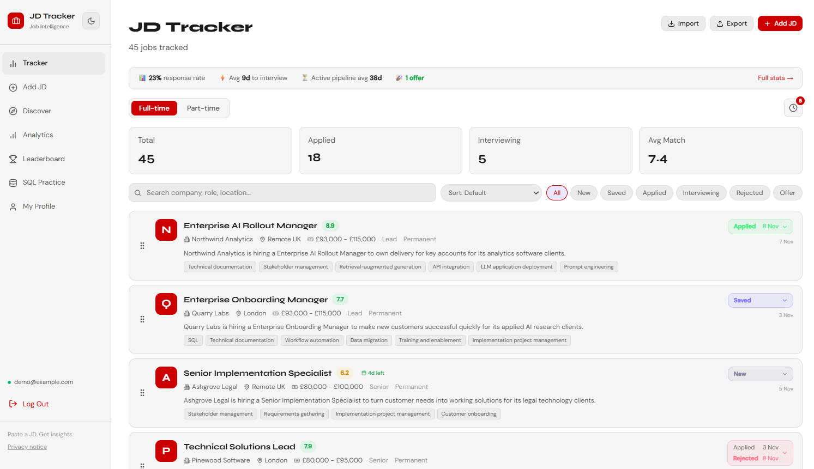
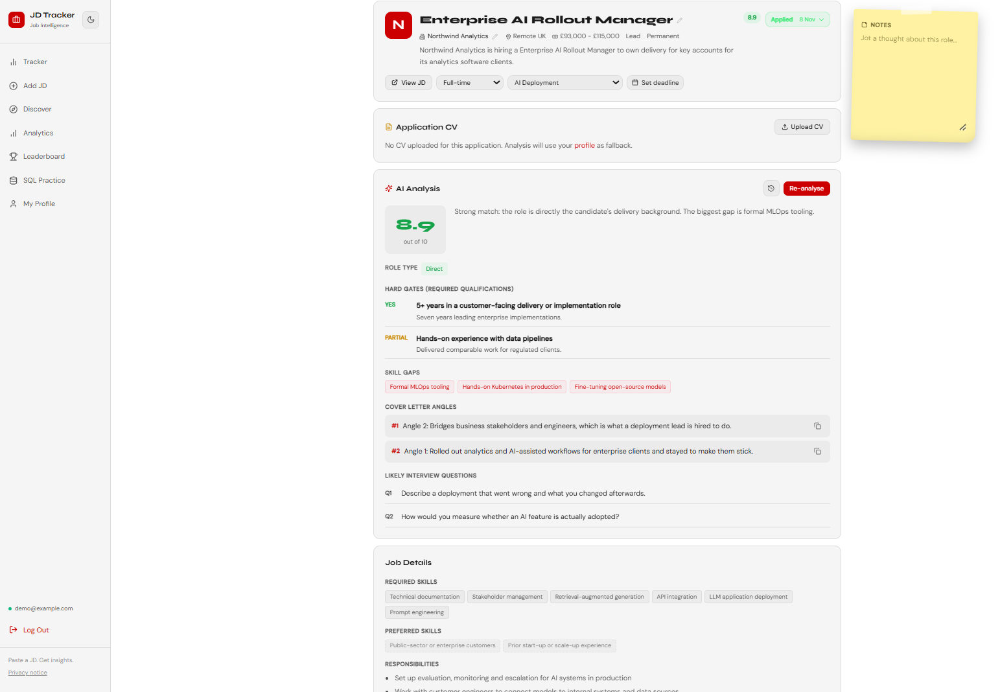
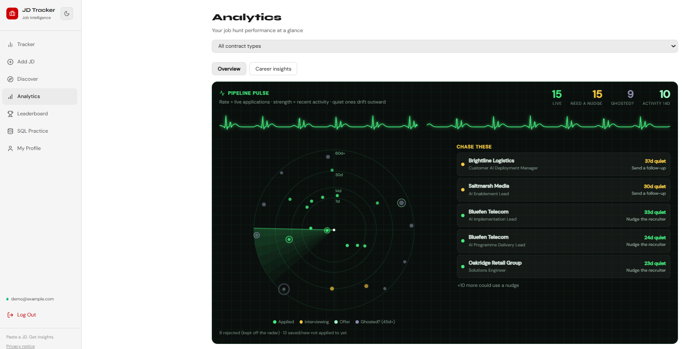
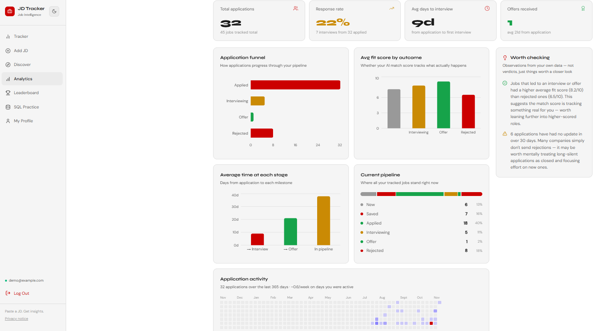
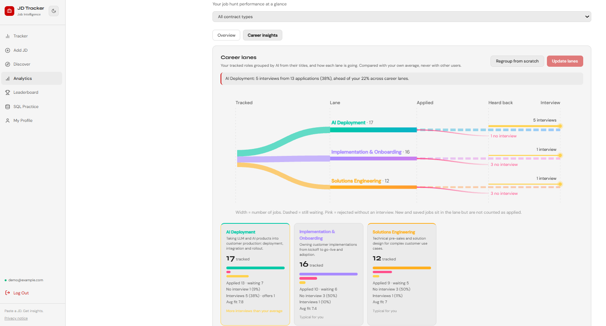
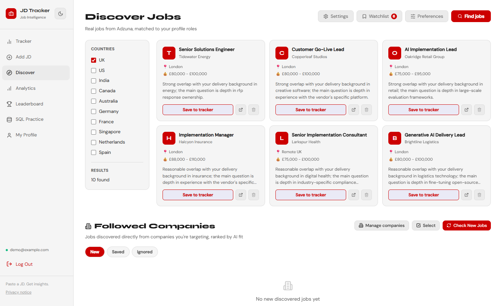
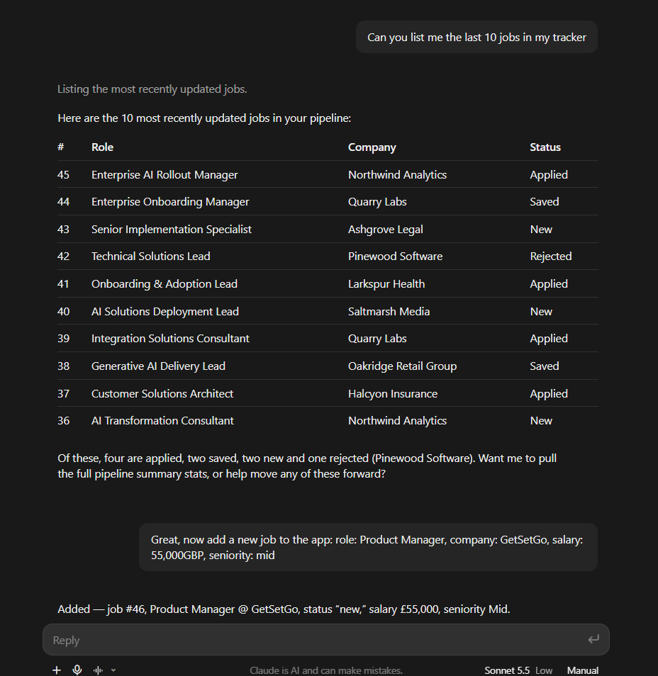

# Job Tracker

A full-stack job-search tracker with AI-assisted matching, an automatic job-discovery engine, analytics, and an MCP server so Claude can work with your pipeline.

> **This repository is a showcase.** It documents the architecture, the MCP tool interface and the data model. The application source is private and no user data or credentials appear here.

## What it does

- **Track jobs on a board.** Paste a job description or URL and AI extracts the role, company, skills and salary. Drag to reorder, move jobs through New, Saved, Applied, Interviewing, Offer and Rejected.
- **Match against your profile.** AI compares each job with your CV and profile, with a score, skill gaps, cover-letter angles and interview questions. Every run is kept as history.
- **Discover jobs automatically.** Search through the Adzuna API, or follow companies and scan their careers pages (Greenhouse, Lever, Ashby and generic HTML). Matches go to a review queue before they become real jobs.
- **Company watchlist.** A lightweight list of companies to keep in mind, with optional AI suggestions.
- **Analytics.** Funnel, response rate, time to interview, a pulse radar, an application heatmap, and **career lanes**: AI groups your roles by function and shows which lanes get interviews and which get rejected without one, always compared with your own average.
- **Leaderboards.** Private groups with a blended score that favours fit over volume.
- **SQL practice.** An in-browser SQLite copy of your own jobs with guided challenges. Nothing is sent to a server.
- **Excel export and import**, to move jobs between accounts.
- **MCP server.** Claude Desktop or Claude Code can list jobs, read pipeline stats and add a job, with a two-step confirmation on writes. See [MCP tools](docs/mcp-tools.md).

## Built with

| Layer | Technology |
|---|---|
| Frontend | React, TypeScript, Vite |
| Backend | FastAPI, async SQLAlchemy, Pydantic |
| Database | SQLite |
| AI | Google Gemini and OpenAI (the user's own key), behind one client with retries and model fallback |
| Job data | Adzuna API, Playwright for generic careers pages |
| Integration | Model Context Protocol (MCP) server with OAuth 2.1 |
| Auth | JWT, Argon2 password hashes |

## Design choices worth a look

- **Consent before any AI call.** Every request that would send text to an AI provider passes one gate on the server. Users agree once, in plain language, and can withdraw any time. Without consent the rest of the app still works.
- **Minimum data to the model.** Career lanes are built from job *titles only*. No CV, notes or company names leave the server for that feature.
- **Resilient AI client.** Retries with backoff, per-model settings and a fallback chain, and outages reported as 503 with `Retry-After` instead of generic errors.
- **Numbers come from code, not from AI.** Insights and statistics are computed deterministically so they cannot be invented.
- **Data ownership.** Everything is scoped per user and deleted with the account. Users can export their own data.
- **Two-step writes for AI agents.** The MCP write tool previews first and only writes on an explicit second call.

## Read more

- [Architecture](docs/architecture.md) with diagrams and request flows
- [MCP tools](docs/mcp-tools.md)
- [Data model](docs/data-model.md)

## About

Built by Abhishek Anand as a hands-on project in full-stack development, applied AI and agent integration. https://github.com/meVky/
