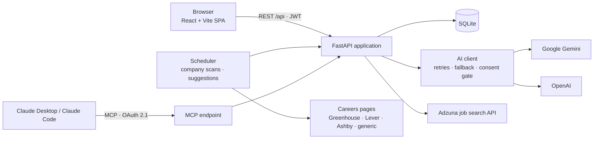
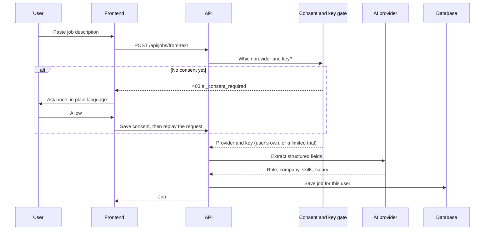

# Architecture

## System overview

The browser talks only to the API. The API owns the database, the AI calls and the integrations. The MCP endpoint is a second front door to the same business logic, so an agent sees exactly what the app sees.

## Main parts

| Part | Responsibility |
|---|---|
| **React SPA** | Tracker board, job detail, Discover, Watchlist, Analytics (including career lanes), Leaderboard, SQL practice, profile and settings. |
| **FastAPI app** | Authentication, per-user data access, job and analytics services, export and import. |
| **AI client** | One entry point for every model call: retries with backoff, per-model "thinking" settings, a fallback chain across models, and clear outage errors. |
| **Consent gate** | Resolves which provider and key a user will use, and refuses to build any AI request if the user has not agreed. |
| **Discovery engine** | Adzuna search plus careers-page scanners (Greenhouse, Lever, Ashby, generic HTML) feeding a review queue. |
| **Scheduler** | Periodic scans and catch-up suggestions, skipped for users who have not consented to AI. |
| **MCP server** | Exposes a small, safe tool set to AI assistants, authenticated with OAuth 2.1. |
| **SQLite** | One database, strict per-user scoping, cascading deletes. |

## Request flow: adding a job from pasted text

## Career lanes flow

1. The user presses **Update lanes** (never automatic, so AI quota is never spent in the background).
2. The server sends **job titles and counts only** to the model, with the user's existing lane names so names stay stable.
3. The answer is validated in code: a cap on the number of lanes, a minimum number of jobs per lane, existing names preserved, unknown output rejected.
4. All numbers and insight sentences are computed from the database. Part-time and bridge work is detected from each job's contract type, not guessed by the model, and is shown as its own group.

## Security and privacy notes

- Passwords are hashed with Argon2. API keys the user provides are stored encrypted.
- Every query is scoped to the signed-in user. Deleting an account cascades through all related tables.
- Sign-in tokens expire after 24 hours and are bumped on password reset.
- A public privacy notice describes what is stored, who receives it and for how long.
- Secrets live in environment configuration and are never committed.
