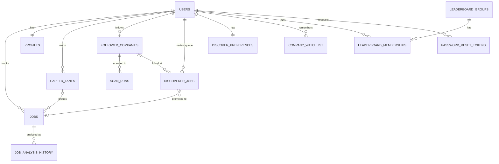

# Data model

SQLite through async SQLAlchemy. Everything is scoped to a user, and deleting a user cascades through every table below.

## Tables

| Table | Purpose | Notable columns |
|---|---|---|
| `users` | Account and per-user settings | email (unique), password hash (Argon2), email verified, token version (bumped on password reset to invalidate old sign-ins), preferred AI provider, the user's own AI keys (encrypted), limited-trial counter and expiry, AI consent timestamp (null means not asked or withdrawn), discovery and watchlist toggles |
| `jobs` | The central table: a tracked job | status (new, saved, applied, interviewing, offer, rejected), position (drag order), company, role, location, salary range, seniority, contract type, JSON lists for skills, responsibilities and culture signals, match score and AI analysis fields, one timestamp per pipeline stage, optional career lane |
| `profiles` | One profile per user, the baseline for AI matching | current role, background, location, target roles, companies and industries, skills |
| `job_analysis_history` | A snapshot of every analysis run, so re-running never destroys history | match score, skill gaps, cover-letter angles, interview questions, created at |
| `career_lanes` | AI-grouped families of roles, per user | name (unique per user), description, kind (`career`, `bridge`, `other`). Users cannot create or rename lanes; they can move a job between existing ones |
| `followed_companies` | Companies whose careers pages are scanned | parser type (Greenhouse, Lever, Ashby, generic), enabled, last scan status, terms-of-service check result, a manual block |
| `scan_runs` | One row per scan attempt | status, jobs found, jobs new, error, timings |
| `discovered_jobs` | The review queue between "found" and "saved as a real job" | source (followed company or Adzuna), dedup hash, match score and reasoning, status (new, saved, ignored), link to the job it was promoted to |
| `discover_preferences` | One row per user | preferred locations and titles, keywords and exclusions, minimum salary, remote and visa filters, minimum match score |
| `company_watchlist` | A lightweight "don't forget this company" list | source (manual or AI-suggested), industry, stage, AI reasoning, relevance score, manual rank, status |
| `leaderboard_groups`, `leaderboard_memberships` | Private groups and who is in them | invite code, owner, joined at |
| `password_reset_tokens` | Single-use reset links | token hash, expiry (1 hour), used flag |

## Design notes

- **Rankings are not stored.** Leaderboard standings are computed from `jobs` on every request, so there is nothing to keep in sync.
- **Part-time and bridge work is derived.** A career lane counts as part-time when most of its jobs have the Part-time contract type. It is computed when read, not stored.
- **Lifecycle timestamps over status alone.** Each pipeline stage keeps its own date, so response time and time to interview can be calculated even after a job moves on.
- **Loose coupling on purpose.** Promoting a discovered job or a watchlist entry only sets a nullable link, so removing the promoted record never deletes the original.
- **Cascade deletes.** Removing a user removes their jobs, history, lanes, scans, queue, watchlist, memberships and reset tokens.

## Client-side only: the SQL practice tables

The SQL practice page builds three throwaway tables in the browser from the user's own jobs and never writes them back:

- `jobs`: core fields and stage dates. Job text, CV text, notes and AI analysis are deliberately not copied.
- `job_events`: one row per milestone (applied, interviewed, offer, rejected).
- `job_skills`: one row per required or preferred skill.
